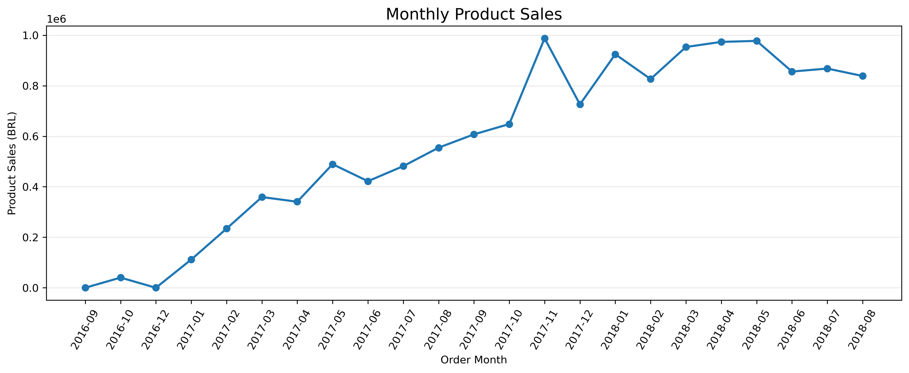
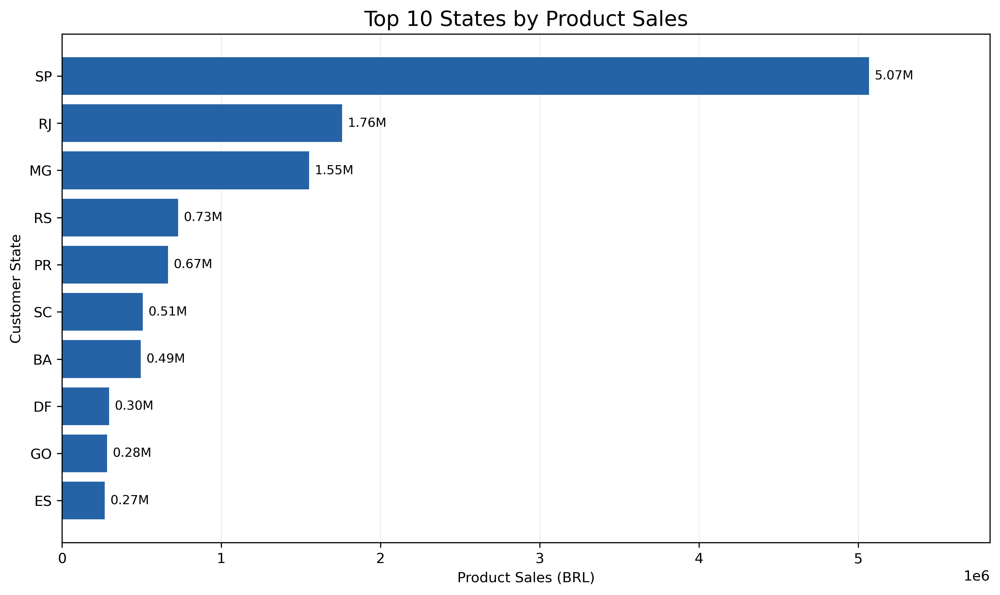
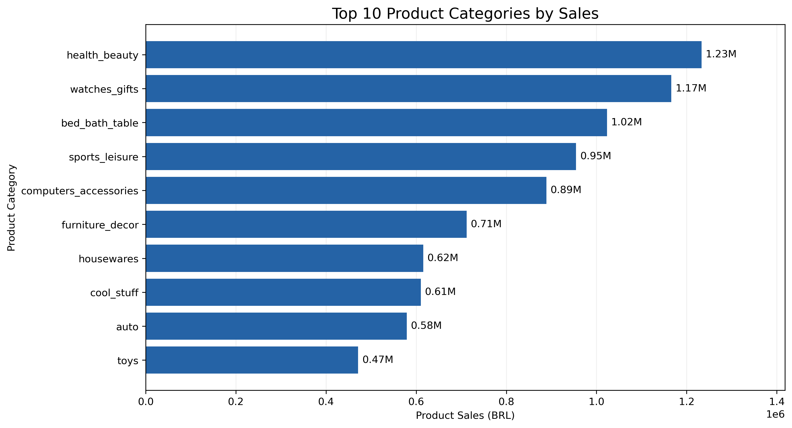
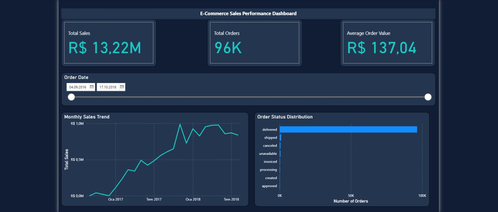

# E-Commerce Sales Analytics

## Project Overview

This project explores sales performance using the Brazilian E-Commerce Public Dataset by Olist.

The analysis focuses on order patterns, product sales, customer locations, and product categories. The goal is to identify business trends and present the findings through Python-based data analysis and visualizations.

## Dataset

Source: [Brazilian E-Commerce Public Dataset by Olist](https://www.kaggle.com/datasets/olistbr/brazilian-ecommerce)

The dataset contains approximately 100,000 orders from 2016 to 2018.

The analysis uses order, order item, customer, product, and category translation data.

Raw CSV files are not included in this repository.

## Tools and Libraries

- Python
- Pandas
- Matplotlib
- Spyder

## Analysis Process

1. Loaded and explored multiple CSV datasets.
2. Checked missing values, duplicate records, and data types.
3. Converted date columns into datetime format.
4. Filtered delivered orders for product sales analysis.
5. Merged order, product, and customer tables.
6. Calculated sales KPIs and monthly trends.
7. Analyzed regional sales and product categories.
8. Created visualizations using Matplotlib.

## Key Metrics

The following metrics are based on delivered orders and exclude shipping costs.

| Metric | Value |
|---|---:|
| Total Orders in Dataset | 99,441 |
| Delivered Orders | 96,478 |
| Total Product Sales | R$13,221,498.11 |
| Average Order Value | R$137.04 |

## Key Findings

- Sao Paulo (SP) generated the highest product sales value, approximately R$5.07 million.
- Health & Beauty was the leading product category, generating approximately R$1.23 million.
- November 2017 recorded a notable increase in monthly product sales.
- Eight delivered orders had missing actual delivery dates.
- 1,559 order-item records had missing English product category labels.

## Visualizations

### Monthly Product Sales



### Top 10 States by Product Sales



### Top 10 Product Categories



## SQL Analysis

In addition to the Python analysis, this project includes SQL queries developed using Microsoft SQL Server.

The SQL analysis covers:

- Data validation and record count verification.
- Sales performance analysis using `INNER JOIN`, `SUM()`, and `GROUP BY`.
- Month-over-month sales growth using Common Table Expressions (CTEs) and `LAG()`.
- Monthly sales rankings using the `RANK()` window function.

The analysis focuses on delivered orders and uses validated product prices, excluding shipping costs from product sales.

### SQL Files

- `sql/01_data_validation.sql` — Dataset validation and record counts.
- `sql/02_sales_analysis.sql` — Monthly sales analysis, growth calculations, and sales rankings.

**Technologies:** Microsoft SQL Server, T-SQL, Python, Pandas, Matplotlib.


## Power BI Dashboard

An interactive Power BI dashboard was developed using data imported from Microsoft SQL Server.

### Dashboard Features

- **Total Sales:** R$13.22M (delivered orders)
- **Total Orders:** 96,478 delivered orders
- **Average Order Value:** R$137.04
- **Monthly Sales Trend:** Sales performance over time
- **Order Status Distribution:** Breakdown of orders by status
- **Date Slicer:** Interactive filtering by order purchase date

### Power BI File

`powerbi/ECommerce_Sales_Dashboard.pbix`

**Tools:** Power BI Desktop, DAX, Power Query, Microsoft SQL Server.
  

## How to Run

1. Download the dataset from Kaggle.
2. Extract the CSV files into the `data` folder.
3. Install the required Python libraries:

```bash
pip install pandas matplotlib
```

4. Run `01_data_exploration.py`.

The charts will be saved automatically in the `outputs` folder.

## Project Limitations

- Product sales are calculated using item prices from delivered orders, excluding shipping.
- Product sales values should not be interpreted as net profit.
- Missing category labels are grouped under "Unknown" in the category visualization.
- Monthly comparisons should account for incomplete periods in the source data.

## Data Attribution

Dataset: Olist Brazilian E-Commerce Public Dataset, available on Kaggle.

Dataset license: CC BY-NC-SA 4.0.

## Power BI Dashboard


